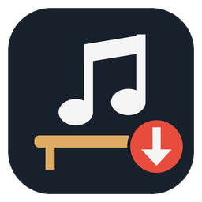
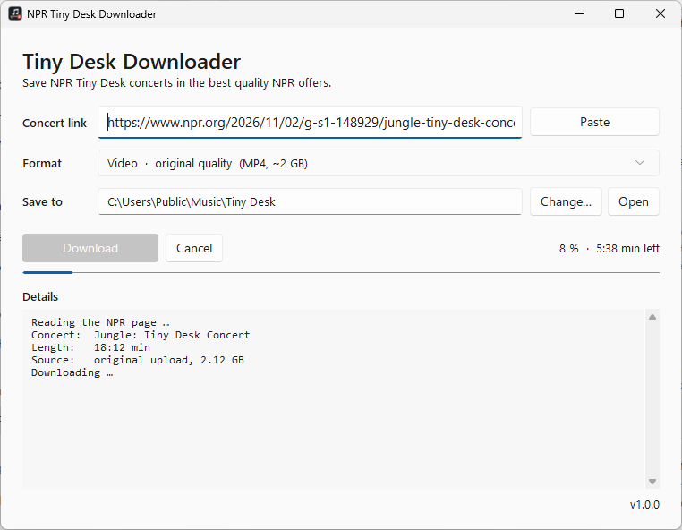

<div align="center">



# NPR Tiny Desk Downloader

**Save NPR Tiny Desk concerts as audio or video – in the best quality NPR actually has.**
One click, no installation, Windows 10/11.

[](https://github.com/Sternpaul/npr-tdc-downloader/releases/latest)
[](https://github.com/Sternpaul/npr-tdc-downloader/actions/workflows/release.yml)
[](LICENSE)



</div>

## Why?

The audio you get from the NPR website's player or from `yt-dlp` is a
re-encoded copy at **~112 kbps**. NPR's video player also keeps the **original
upload** around – and its audio track is **~320 kbps AAC at 48 kHz**, roughly
three times the bitrate. This app fetches exactly that file and copies the
streams **without re-encoding**, so nothing is lost.

| | Audio | Video |
|---|---|---|
| NPR website / yt-dlp `bestaudio` | AAC 112 kbps, 44.1 kHz | up to 1080p, 3.5 Mbit/s |
| **This app – original quality** | **AAC ~320 kbps, 48 kHz** | **1080p, ~15 Mbit/s** (the studio upload) |

## Features

- **The whole Tiny Desk catalogue built in** – every concert since 2008 (~1,850), searchable
  by artist or description, filterable by year. Select one or many and click
  **Download best audio** or **Download best video**; they are queued and saved one after another.
  New concerts are picked up automatically.
- **Or paste a link** to any concert page.
- **Audio** (`.m4a`) or **video** (`.mp4`, always with its audio): original quality, or smaller 1080p / 720p versions.
- **"Saved" column** shows which concerts you already have; tick *Not saved yet* to hide them.
- **Tagged files**: artist, title, date, album *NPR Tiny Desk Concerts* and the cover picture
  – they show up nicely in any music player. If tagging fails, the download is still kept.
- **Progress bar with time left**, cancel at any time (no half-finished files left behind).
- Skips concerts you already have, checks free disk space before big downloads.
- Light and dark mode (follows Windows), remembers your format and folder.
- **Everything is inside one `.exe`** – Python, FFmpeg and all libraries. Nothing to install.
- Works for older concerts too (see [sources by era](#older-concerts)).

## Download & use

1. Download **`NPR-TDC-Downloader.exe`** from the
   [latest release](https://github.com/Sternpaul/npr-tdc-downloader/releases/latest).
2. Put it in the folder where your concerts should go (e.g. `Music\Tiny Desk`) and double-click it.
3. In the **Catalogue** tab, search for an artist (or scroll), select one or more concerts
   (Ctrl/Shift + click), and click **Download best audio** or **Download best video**.
4. Or use **Paste a link**: copy a concert's address from your browser – the app pastes it
   for you – pick a format and click **Download**.

Files are saved next to the `.exe` unless you pick another folder with **Change…**.

> [!NOTE]
> **"Windows protected your PC"** – the first time you start it, Windows SmartScreen
> warns about apps that are not code-signed. Click **More info → Run anyway**.
> Each release lists the SHA-256 checksum of the exe if you want to verify your download.

> [!TIP]
> **Why does an audio download take a few minutes?** The original audio only exists
> inside the original video file (~2 GB for a 20-minute concert). The app streams that
> file and keeps only the sound. Speed depends on your internet connection.

### Formats

| Format | File | Typical size (20 min) | Notes |
|---|---|---|---|
| Audio · original quality | `.m4a` | ~45 MB | best audio; download time ≈ original video |
| Video · original quality | `.mp4` | ~2 GB | the unmodified studio upload |
| Video · 1080p compressed | `.mp4` | ~500 MB | NPR's web version, 112 kbps audio |
| Video · 720p compressed | `.mp4` | ~300 MB | NPR's web version, 112 kbps audio |

### Command line

The exe also accepts a link, which fills it in and starts right away:

```bat
NPR-TDC-Downloader.exe "https://www.npr.org/2026/11/02/g-s1-148929/jungle-tiny-desk-concert" --format video
```

`--format` is one of `audio` (default), `video`, `video1080`, `video720`.

## How it works

1. Reads the NPR page and finds the embedded **JW Player** media ID
   (e.g. `cdn.jwplayer.com/manifests/PlKLO4B7.m3u8`), the title and the publish date.
2. Asks the public JW Player API (`cdn.jwplayer.com/v2/media/<id>`) for all renditions.
   Besides the usual 180p–1080p MP4s and HLS stream, it lists a **`Passthrough`** source:
   the originally uploaded file.
3. Runs `ffmpeg -c copy` on that source to remux the audio (or audio + video) into
   `.m4a` / `.mp4` – no re-encoding, so no quality loss.
4. Writes MP4 tags and cover art with [mutagen](https://github.com/quodlibet/mutagen).

### Older concerts

NPR's pages changed over the years, so the app picks the best source a page has:

| Era (roughly, from sampling the archive) | What NPR has | Best audio | Best video |
|---|---|---|---|
| 2019 – today, 2009, part of 2008 | JW Player original upload | AAC ~320 kbps (`.m4a`) | original 1080p (`.mp4`) |
| 2010 – 2017, part of 2008 | NPR's own 720p MP4 | AAC, ~125–320 kbps depending on the concert (`.m4a`) | 720p (`.mp4`) |
| 2018 | JW Player, mostly without the original upload | AAC from the 1080p version (`.m4a`) | 1080p (`.mp4`) |
| pages with only an MP3 | MP3 | MP3 as published (`.mp3`) | from YouTube if the page embeds it |
| pages with only a YouTube embed | YouTube | via [yt-dlp](https://github.com/yt-dlp/yt-dlp) | via yt-dlp |

Audio and video are always copied as-is (no re-encoding), so the result is exactly what NPR stores.

### The catalogue

The list comes from NPR's archive pages
(`npr.org/series/tiny-desk-concerts/archive?date=MM-DD-YYYY`, 15 concerts per page, newest first).
A full scan walks every year in parallel (~100 pages, about a minute); release builds ship a
snapshot of it so the list is there instantly. After that, the app checks for new concerts on
every start and when you click **Refresh** (usually a single page load) and writes the result to
the log, e.g. *Catalogue updated: 2 new concerts – Fat Joe (2026-11-05), Jungle (2026-11-02).*

The **Saved** column comes from the app's download history: every finished download is recorded
with its file path, and a concert counts as saved while that file still exists. Files from
other tools, or ones you moved or renamed, are not recognised. The catalogue, your settings
and the download history live in `%APPDATA%\NPR Tiny Desk Downloader\`.

## Build it yourself

Requirements: Windows, Python 3.12+, and an `ffmpeg.exe`.

```bash
git clone https://github.com/Sternpaul/npr-tdc-downloader.git
cd npr-tdc-downloader
pip install -r requirements.txt
python -m unittest discover -s tests       # offline tests
python src/npr_tdc_downloader.py           # run from source (uses ffmpeg from PATH)
python build.py --ffmpeg C:\path\to\ffmpeg.exe --catalogue   # -> dist/NPR-TDC-Downloader.exe
```

`build.py` looks for `ffmpeg.exe` in `./ffmpeg/` or on `PATH` if `--ffmpeg` is not given.
`--catalogue` scans NPR's archive and bundles the result (optional; without it the app scans on first start).

Code layout: `src/tdc/core.py` (finding sources, downloading, tagging),
`src/tdc/catalogue.py` (archive scan), `src/tdc/gui.py` (window and download queue),
`src/npr_tdc_downloader.py` (entry point).
The icon is generated by `tools/make_icon.py`.

## Releases

Releases are built by GitHub Actions ([`release.yml`](.github/workflows/release.yml)):

```bash
git tag v1.0.0
git push origin v1.0.0
```

The workflow runs the tests, downloads the newest stable LGPL FFmpeg build from
[BtbN/FFmpeg-Builds](https://github.com/BtbN/FFmpeg-Builds) (checksum-verified),
scans the catalogue, builds the exe with version info, checks that it starts, and publishes a release with
the exe, its SHA-256 checksum and the FFmpeg license. Tags with a `-` (e.g. `v1.1.0-beta.1`)
become pre-releases. Running the workflow manually builds a test exe as an artifact only.

## Disclaimer

This project is not affiliated with, endorsed by, or connected to NPR. Tiny Desk
concerts are © NPR and the performing artists. Use this tool only to save concerts for
your own personal listening, and respect NPR's
[terms of use](https://www.npr.org/about-npr/179876898/terms-of-use). Do not
redistribute downloaded recordings.

## License

[MIT](LICENSE) for the code in this repository. The release exe bundles third-party
software under its own licenses – see [THIRD-PARTY-NOTICES.md](THIRD-PARTY-NOTICES.md).
